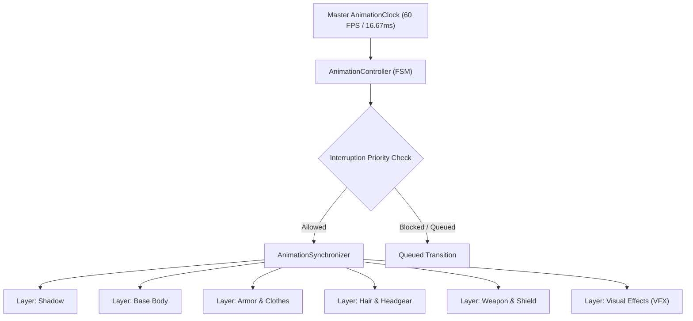

# QUY TRÌNH HOẠT ẢNH & ĐỒNG BỘ ĐA LỚP
## ELYSIA NO DENSETSU – ANIMATION PIPELINE SPECIFICATION

Tài liệu này đặc tả quy trình vận hành hoạt ảnh (Animation Pipeline) cho hệ thống nhân vật Paper Doll đa lớp trong ELYSIA NO DENSETSU.

---

### 1. KIẾN TRÚC TỔNG THỂ

---

### 2. CƠ CHẾ NGẮT HOẠT ẢNH (INTERRUPTION RULES)

| Trạng thái | Độ ưu tiên | Hành vi khi nhận lệnh mới |
| :--- | :---: | :--- |
| **`death`** | **5 (Cao nhất)** | Tuyệt đối không bị ngắt quãng bởi bất kỳ lệnh nào (di chuyển, tấn công, trúng đòn). Chỉ chuyển sang `idle` khi nhân vật được hồi sinh (revive). |
| **`hurt`** | **4** | Ngắt quãng ngay lập tức các trạng thái `idle`, `walk`, `run`, `attack`, `skill`. Chỉ bị ngắt nếu nhân vật chết (`death`). |
| **`attack` / `skill`** | **3** | Không bị ngắt bởi lệnh di chuyển (`walk`, `run`). Nhân vật thực hiện trọn vẹn cú vung vũ khí. Bị ngắt ngay nếu bị choáng/trúng đòn (`hurt`) hoặc tử trận (`death`). |
| **`walk` / `run`** | **1** | Bị ngắt ngay lập tức khi người chơi tung chiêu hoặc trúng đòn. |
| **`idle`** | **0** | Trạng thái nghỉ mặc định, sẵn sàng chuyển đổi sang mọi trạng thái khác. |

---

### 3. ĐỒNG BỘ KHUNG HÌNH ĐA LỚP (ZERO-DESYNC SYNCHRONIZATION)

Trong các game 2D thông thường, nếu từng Sprite (áo, tóc, kiếm) có Sprite riêng và chạy `play()`, FPS không ổn định của trình duyệt sẽ làm kiếm vung ở frame 3 trong khi tay nhân vật vẫn ở frame 1 (hiện tượng rách hình Paper Doll).

Trong **ELYSIA NO DENSETSU**, điều này được giải quyết triệt để:
1. `AnimationClock` tính toán lượng thời gian trôi qua `deltaMs` chính xác bằng `performance.now()`.
2. `AnimationSynchronizer` tính toán `currentFrame` và `progress (0.0 .. 1.0)` tập trung.
3. Mọi lớp trang bị (`SpriteLayer`) chỉ nhận giá trị frame từ `AnimationSynchronizer` chung trong cùng 1 frame render của Canvas/Phaser.
