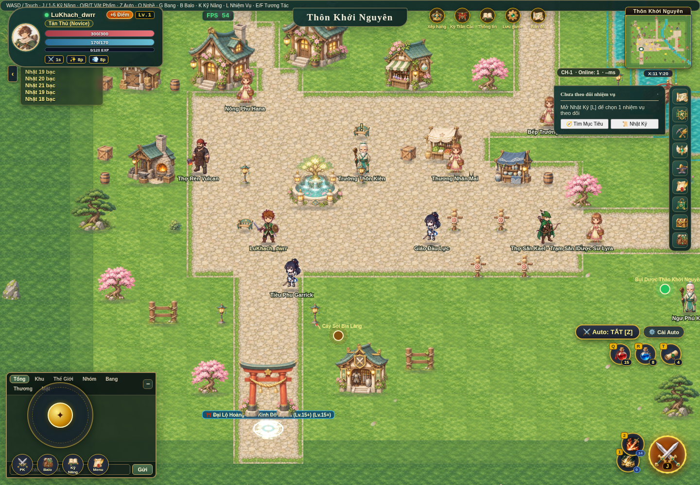
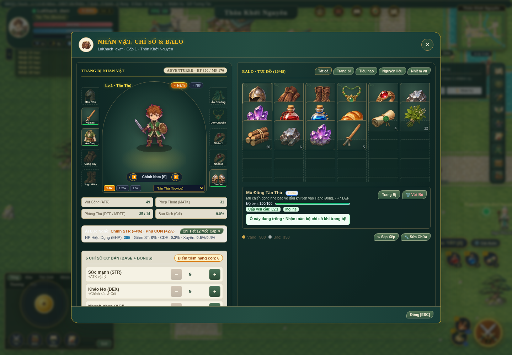
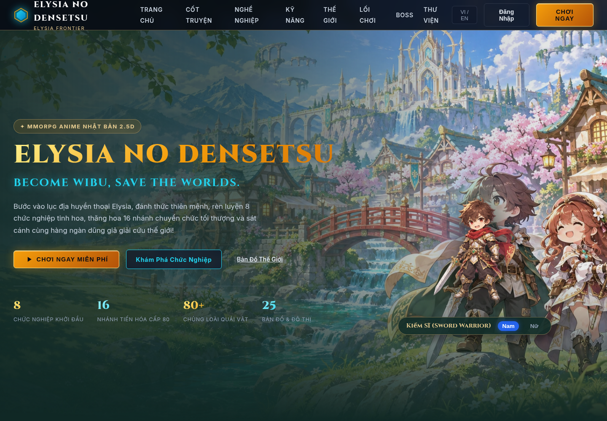

# Fantasy artwork refresh — 2026-11-17

This revision publishes **407 raster assets** using a shared hand-painted anime fantasy direction: jade roofs, ivory stone, honey wood, gold trim, sage foliage and sakura pink. All 80 monster IDs receive individually illustrated creatures, including regional elites and bosses. Village architecture, cathedral furnishings, terrain, transitions, portraits, class illustrations, inventory icons, HUD buttons, skill thumbnails and landing key art share the new palette.

## Preview







## Source and export workflow

Approved generated PNG originals are kept in `art-production/source/refresh/`. `art-production/pack_refresh.py` exports them into the established runtime paths. It preserves manifest dimensions, fits isolated sprites to the existing foot baseline, measures nonuniform atlas gutters and extracts the main silhouette for the five closely packed final-row boss cutouts. It does not fabricate animation frames or recolor existing sprites into new monsters.

The machine-readable inventory is `art-production/refresh-exports.json`: every exported URL, source atlas, cell, dimensions and SHA-256 digest. New UI icons use local PNG images inside the existing SVG-returning API, so inventory and HUD consumers share the same artwork. Canonical item keys resolve before aliases, preventing collisions such as `mushroom_cap` being mistaken for a helmet.

With Python 3.9+ and Pillow installed:

```sh
python art-production/pack_refresh.py
python art-production/validate_refresh.py
```

## Integration fixes

- Inventory thumbnails are contained inside their cells; HUD utility buttons and consumables use painted icons instead of emoji.
- The landing page occupies its own scrolling overlay above the game canvas. Navigation observes that scroll container, and the new background remains visible behind readable text.
- Character inspection reads the actual 192×160, two-frame-per-facing job atlases. The female novice source uses 128×128 front-facing frames. Frame rectangles now stay inside the real PNGs, and aspect ratio is preserved.
- Arbitrary weapon PNGs and the test shield icon are no longer projected over the character as unmatched paperdoll layers. Equipment remains visible in its slots; the center preview displays the authored base outfit. Registered compatible layers remain supported.
- Client TypeScript accepts the repository's existing `.ts` imports with `noEmit`, and equipment mappings use canonical armor/cloak slot names.

## Coverage and limits

The original repository contains **1,078 image files**. This is a broad refresh across its visible asset categories, **not a redraw of all 1,078 files**. The 23 registered animation atlases and 44 combat VFX sheets retain their authored frames and timing; skill thumbnails and surrounding presentation are refreshed. Unused legacy/reference imagery remains available. Female job inspection still falls back to the existing shared job atlases; only the female novice source has its own authored sheet, and it has a single facing.

The 16 skill icon motifs are intentionally shared by related abilities. No claim is made that every ability now has a unique illustration. Terrain remains a tile-based map; its texture repetition can still be visible at large zoom levels.

## Validation

- Client production build passes.
- All **27 client tests** pass, including real two-player multiplayer integration, catalog icon alias resolution, and source-rectangle checks against all 26 registered preview configurations.
- `validate_refresh.py` decodes all **281 runtime assets** and checks dimensions/alpha contracts, then verifies all **407 exported image hashes and dimensions**.
- `node scripts/validate-visual-asset-overhaul.mjs` passes the existing world/monster/placement audit.
- Chromium checks cover guest startup, village, inventory, skills, movement/basic attack, and desktop/mobile landing views. All 281 artwork paths load; no page errors, failed HTTP responses or broken loaded image elements were observed in that run.

Vite still reports the pre-existing bundle-size advisory; bundle splitting is outside this artwork revision.
