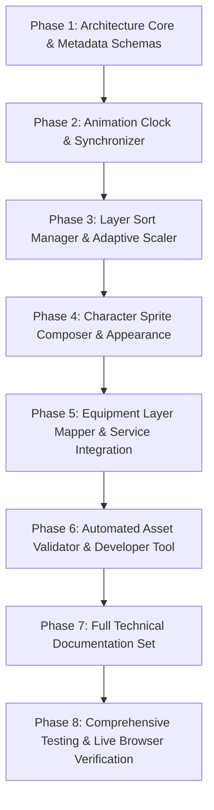

# ELYSIA NO DENSETSU – MODULAR LAYERED SPRITE IMPLEMENTATION PLAN

**Target:** Enterprise-grade 2D Anime Fantasy Modular Layered Sprite System  
**Phases:** 8 Sequential Execution Phases  

---

## Phase Breakdown

### Phase 1: Architecture Core & Metadata Schemas
- Build `src/assets/AssetManifest.ts`: Type definitions & validation for Character Manifest, Animation Metadata, and Equipment Manifest.
- Build `src/assets/AssetRegistry.ts` & `src/assets/AssetLoader.ts`: Central registry and async caching loader.

### Phase 2: Animation Clock & Synchronizer
- Build `src/rendering/animation/AnimationClock.ts`: Master timeline clock.
- Build `src/rendering/animation/DirectionResolver.ts`: 8-direction resolution and 4-direction fallback mapping.
- Build `src/rendering/animation/AnimationSynchronizer.ts`: Synchronizes all active layers to identical frame index, duration, and progress.
- Build `src/rendering/animation/AnimationController.ts`: State machine with attack, hurt, and death interruption rules.

### Phase 3: Layer Sort Manager & Adaptive Scaler
- Build `src/rendering/sprites/LayerSortManager.ts`: Resolves dynamic render order based on direction (0..7) and animation clip.
- Build `src/rendering/sprites/SpriteAnchorManager.ts`: Standard anchor points (`head`, `right_hand`, `left_hand`, `back`, `feet`).
- Build `src/rendering/sprites/AdaptiveSpriteScaler.ts`: Normalizes dimensions based on `referenceHeight`, `pixelsPerUnit`, and preserves ground pivot.

### Phase 4: Character Sprite Composer & Appearance
- Build `src/rendering/sprites/SpriteLayer.ts`: Individual layer definition.
- Build `src/rendering/sprites/SpriteComposer.ts`: Assembles base body, hair, armor, weapons, accessories, and VFX.
- Build `src/rendering/sprites/LayerRenderer.ts`: Canvas & Phaser renderer.
- Build `src/characters/CharacterAppearance.ts`: Holds the visual equipment state for players and multiplayer entities.

### Phase 5: Equipment Layer Mapper & Service Integration
- Build `src/equipment/EquipmentLayerMapper.ts`: Maps inventory items to visual sprite layers, anchor profiles, and render orders.
- Integrate with `CharacterPreview` and `GameEngine` entity rendering.

### Phase 6: Automated Asset Validator & Developer Tool
- Build `src/assets/AssetValidator.ts`: Automated tool checking missing files, invalid PNGs, transparency, dimensions, direction gaps, and pivots.
- Generate `docs/ASSET_VALIDATION_REPORT.md`.

### Phase 7: Full Technical Documentation Set
- Generate 5 comprehensive guides in `docs/`:
  - `SPRITE_TECHNICAL_SPECIFICATION.md`
  - `ASSET_DIRECTORY_GUIDE.md`
  - `SPRITE_IMPORT_GUIDE.md`
  - `ANIMATION_PIPELINE.md`
  - `CHARACTER_LAYERING_GUIDE.md`
  - `EQUIPMENT_SPRITE_GUIDE.md`
  - `SPRITE_SYSTEM_TEST_REPORT.md`

### Phase 8: Comprehensive Testing & Live Browser Verification
- Unit & integration tests in `apps/game-client/tests/layered-sprite-system.test.mjs`.
- Execute full monorepo test suite (`pnpm test`).
- Live browser verification on `http://localhost:3000` with Playwright screenshot.
