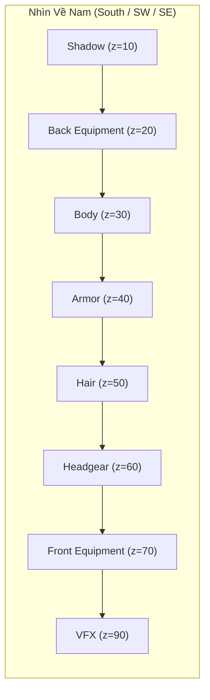
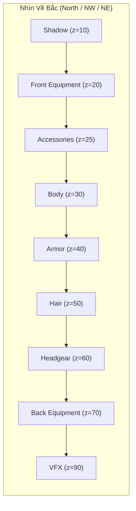

# QUY CHUẨN KỸ THUẬT SPRITE & RENDERING 2D LAYERED
## ELYSIA NO DENSETSU – MODULAR PAPER DOLL SYSTEM

---

### 1. QUY CHUẨN HỆ THỐNG TỌA ĐỘ VÀ 8 HƯỚNG DI CHUYỂN

Hệ thống nhân vật sử dụng quy chuẩn 8 hướng di chuyển chuẩn (`0` đến `7`), với góc tính theo chiều kim đồng hồ bắt đầu từ Chính Nam (0° vector `(0, 1)` trên không gian màn hình Canvas/Phaser):

```
               [4] North (180°)
                     |
  [3] North-West     |     [5] North-East (135°)
        (225°)       |
                     |
[2] West (270°) -----+----- [6] East (90°)
                     |
  [1] South-West     |     [7] South-East (45°)
        (315°)       |
                     |
               [0] South (0°)
```

#### Bảng Ánh Xạ Vector & Fallback 4 Hướng

| Index | Tên Hướng | Vector Chuẩn `(dx, dy)` | Góc Độ | 4-Direction Fallback |
| :---: | :--- | :---: | :---: | :---: |
| **0** | `south` | `(0, 1)` | 0° | `south` |
| **1** | `south_west` | `(-0.707, 0.707)` | 315° | `west` |
| **2** | `west` | `(-1, 0)` | 270° | `west` |
| **3** | `north_west` | `(-0.707, -0.707)` | 225° | `west` |
| **4** | `north` | `(0, -1)` | 180° | `north` |
| **5** | `north_east` | `(0.707, -0.707)` | 135° | `east` |
| **6** | `east` | `(1, 0)` | 90° | `east` |
| **7** | `south_east` | `(0.707, 0.707)` | 45° | `east` |

---

### 2. PHÂN LỚP ĐỒ HỌA (MODULAR PAPER DOLL LAYERS)

Để người chơi có thể thay đổi ngoại hình theo từng trang bị (vũ khí, giáp, mũ, áo choàng, cánh, kiểu tóc) mà không phải vẽ toàn bộ tổ hợp sprite sheet, nhân vật được phân tách thành 9 lớp render độc lập:

1. **`shadow`**: Bóng đổ elip dưới chân, nhân vật tiếp xúc với mặt đất.
2. **`back_equipment`**: Áo choàng, cánh, balo, ống tên, khiên đeo lưng.
3. **`body`**: Khung cơ thể cơ bản (Nam/Nữ, da trắng/ngăm, nghề nghiệp).
4. **`armor`**: Áo giáp ngực, váy, giáp chân.
5. **`hair`**: Kiểu tóc và màu tóc theo tùy chọn.
6. **`headgear`**: Nón, vương miện, băng đô, mặt nạ.
7. **`accessories`**: Khuyên tai, dây chuyền, phù hiệu.
8. **`front_equipment`**: Vũ khí cầm tay phải, khiên cầm tay trái.
9. **`vfx`**: Hiệu ứng hào quang, vệt chém kỹ năng, lửa thần thánh.

---

### 3. THUẬT TOÁN ĐỘ SÂU ĐỘNG (DIRECTION-AWARE DEPTH SORTING)

Thứ tự vẽ từ sau ra trước (Back-to-Front) phụ thuộc hoàn toàn vào góc nhìn của nhân vật:





---

### 4. ĐỒNG BỘ HOÁ HOẠT ẢNH (MASTER ANIMATION CLOCK & SYNCHRONIZER)

Tất cả các lớp trang bị của một nhân vật không được phép có vòng lặp thời gian riêng. Toàn bộ các lớp đăng ký vào `AnimationSynchronizer` chịu sự điều phối của `AnimationClock` (tần số 60 FPS, delta chuẩn 16.67ms):

- **Trạng thái đồng bộ:** Tất cả các lớp bắt đầu cùng frame 0, chuyển frame tại cùng mili-giây, và kết thúc/lặp lại cùng lúc.
- **Interruption Rules:**
  - `death`: Ưu tiên 5 (tuyệt đối không bị ngắt quãng ngoại trừ hồi sinh).
  - `hurt`: Ưu tiên 4 (ngắt quãng đòn đánh, bước chạy, đứng yên).
  - `attack` / `skill`: Ưu tiên 3 (chỉ bị ngắt bởi hurt hoặc death; phím di chuyển không làm gãy đòn đánh).
  - `walk` / `run`: Ưu tiên 1 (có thể ngắt ngay lập tức khi xuất chiêu).
  - `idle`: Ưu tiên 0.
